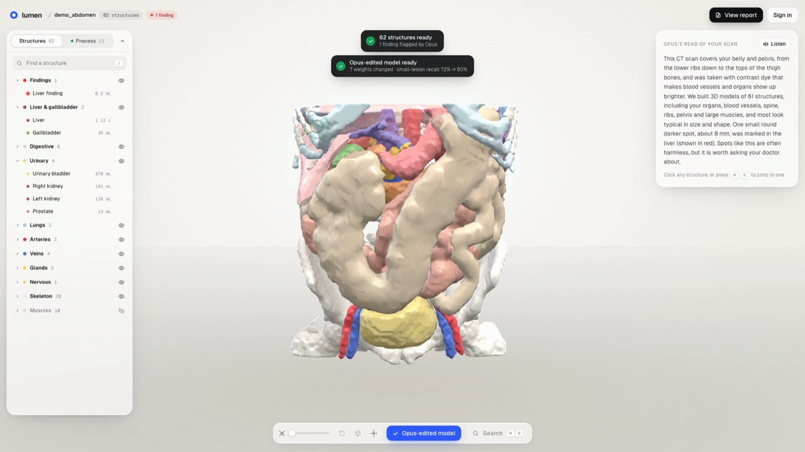
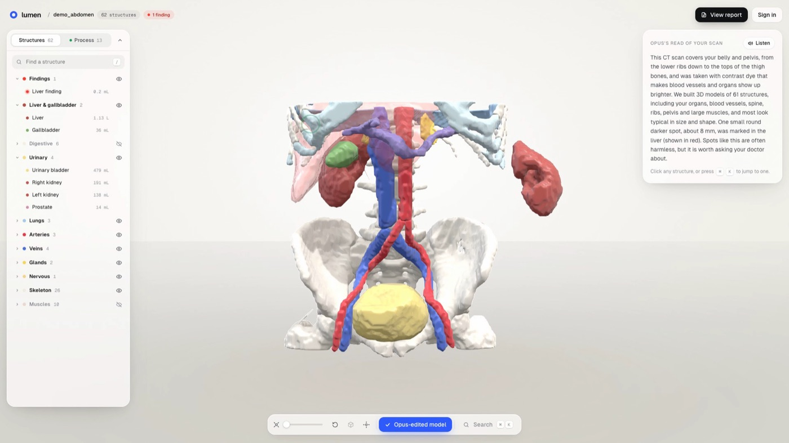
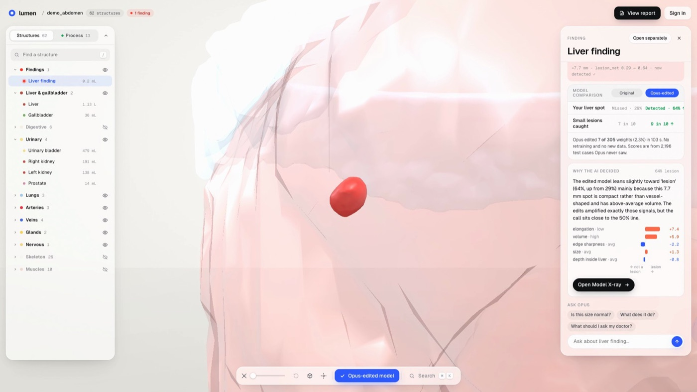
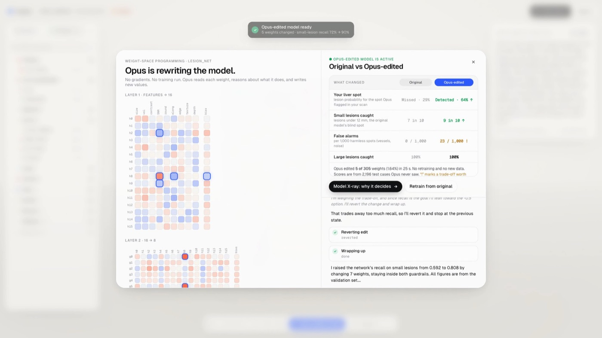
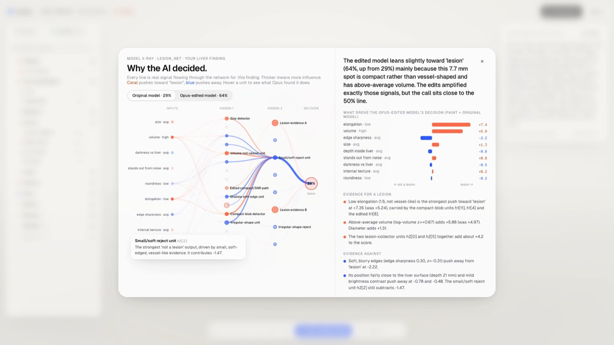
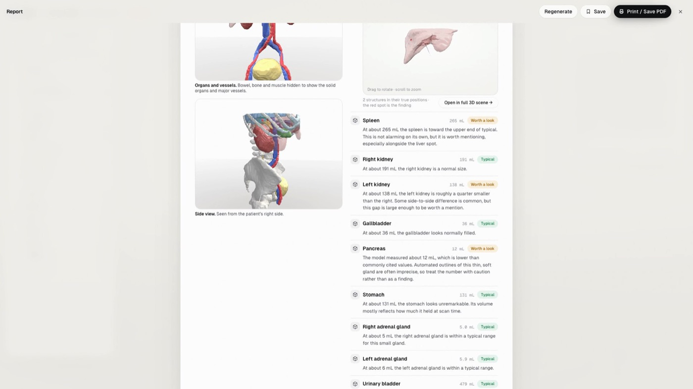

# Lumen: see inside

Upload a CT scan and **Opus 5.5 runs the whole pipeline**. It segments the scan into every organ, bone and vessel, checks its own work visually, builds a separate 3D object for each structure, screens the liver, and explains everything in plain language. It also does **weight-space programming**: it reads a small diagnosis model's weights and edits them directly to fix a known failure, with no gradients and no training run.



🎬 **Demo film (78 s):** [videos/lumen-launch/renders/lumen-hackathon.mp4](videos/lumen-launch/renders/lumen-hackathon.mp4)

| Pull your anatomy apart | Opus flags what the model missed |
|---|---|
|  |  |
| **Opus edits the model's weights** | **Model X-ray: why it decided** |
|  |  |



## Run it

You need two terminals.

```bash
cd api && uv run uvicorn main:app --port 8000
```

```bash
cd web && npm run dev
```

Then open http://localhost:5173.

- **Try the demo scan** does a live Opus run, about 90 s.
- **Instant replay** replays a recorded run, about 20 s, and uses none of your subscription.
- **Train custom model** does a live weight-space session, about 60 s. ⌥-click it to replay the recorded session.

### Auth

- Opus runs on your **Claude Code subscription** through the Claude Agent SDK. Run `claude login` once. Keep `ANTHROPIC_API_KEY` unset; the server also removes it from its environment.
- `.env` holds `OPENROUTER_API_KEY`. Opus uses it through the `ask_model` tool to get second opinions from other vision models.

## How it works

| Piece | File | What it does |
|---|---|---|
| Orchestrator | `api/agent.py` | Opus tool loop: `inspect_volume`, `render_slices`, `zoom_view`, `run_totalsegmentator`, `edit_labels`, `threshold_region`, `organ_stats`, `build_meshes`, `find_liver_lesions`, `report_finding`, `ask_model`, `finalize_scene` |
| Imaging | `api/scan.py` | NIfTI loading in canonical RAS orientation, slice and close-up rendering, label editing, marching cubes, then Taubin smoothing and decimation, exported as one GLB per structure |
| Diagnosis model | `api/wsp/lesion.py` | `lesion_net`, a 9→16→8→1 MLP (305 weights) that scores liver lesion candidates. It was trained on simulated liver tissue with very few small lesions, so it under-calls lesions under 12 mm |
| Weight-space session | `api/wsp/session.py` | Opus gets `get_weights`, `trace`, `feature_sensitivity`, `edit_weights`, `revert_last` and a validation set. It has no optimizer. Results are reported on a held-out test set |
| Model X-ray | `api/wsp/explain.py`, `POST /api/scans/{id}/explain`, `web/src/components/Xray.tsx` | Exact per-finding explanation. lesion_net is piecewise-linear, so the feature contributions, per-neuron contributions and per-connection flow sum exactly to its output. Opus reads the weights and activation profiles, names the circuit units ("compact-blob detector", "small/soft reject unit"…), and writes evidence for and against, what its edits changed, what would flip the call, and a cautious sentence for the report |
| UI | `web/src` | React Three Fiber scene: draggable organs, Reassemble, explode slider, system filters, multi-select, isolate, Ask Opus, live weight heatmap |

## Recorded results (demo case)

| | Before | After |
|---|---|---|
| Small-lesion recall | 72% | 91% |
| False-alarm rate | 0.0% | 0.2% |
| Accuracy | 98.3% | 99.3% |
| Patient's liver lesion score | 0.29 (missed) | 0.63 (detected) |

All numbers are on the held-out test set. Opus changed **8 of 305 weights** (2.6%).

## Honest notes

- The demo CT is the public TotalSegmentator sample (3 mm). One ~8 mm liver lesion was digitally inserted for the demo. The UI labels it "Demo case", and Opus is not told about the inserted lesion.
- lesion_net's training data and test sets are procedurally simulated (lesion insertion into synthetic liver tissue). It is a demonstration model, not a clinical one.
- Lumen is an educational tool. It is not a medical device and does not give a diagnosis.
